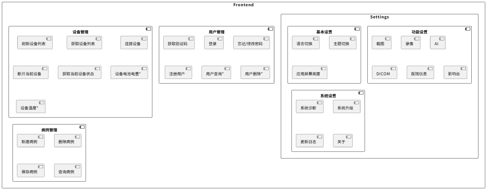

# FrontendDiagram Method

<!-- ```plantuml
@startuml
!include ./Frontend.puml
@enduml
``` -->

- [前端功能简图](#前端功能简图)

- [设备管理](#设备管理)

  - [设备状态](#设备状态)

  - [wifi连接模式](#wifi连接模式)

- [用户管理](#用户管理)

- [病例管理](#病例管理)

- [设置](#设置)

  - [基本设置](#基本设置)

  - [功能设置](#功能设置)

  - [系统设置](#系统设置)

- [数据管理](#数据管理)

  - [媒体管理](#媒体管理)

  - [档案管理](#档案管理)

## 前端功能简图

<!--  -->

## 设备管理

### 设备状态

- 设备电池电量

- 获取设备状态

```cpp
@brief 获取当前连接探头名称
@return 当前连接探头名称
QString currentWifiName();

@brief 获取当前连接探头信号强度
int currentWifiSignalQuality();
```

- 设备电池电量*

```cpp
int batteryLevel();
```

- 设备温度*

```cpp
int temperature();
```

### wifi连接模式

- 刷新设备列表

```cpp
@brief 首先使用此方法刷新设备列表
void refreshDevicesList();
```

- 获取设备列表

``` cpp
@brief QVariantList包含每个设备ssid以及设备信号强度
@return 每个设备ssid以及设备信号强度
QVariantList devicesList();
```

- 连接设备

```cpp
@param _ssid 设备ID
@param _password 设备密码
void connectToWifi(const QString& _ssid, const QString& _password);
```

- 断开当前设备

```cpp
@brief 只需要断开当前连接设备；之后再次选择新设备进行连接即可
void disconnectWifi();
```

## 用户管理

- 获取验证码

```cpp
@param _phoneNumbers 电话号码
@return 是否发送成功
bool getCaptcha(const QString& _phoneNumbers);
```

- 登录

```cpp
@param _phoneNumbers 电话号码
@param _password 账户密码
@return 是否登录成功
bool login(const QString& _phoneNumbers, const QString& _password);
```

- 忘记/修改密码

```cpp
@param _phoneNumbers 电话号码
@param _password 账户密码
@return 是否修改成功
bool revisePassword(const QString& _phoneNumbers, const QString& _password);
```

- 注册用户

```cpp
@param _loginUser 用户对象类
@return 是否注册成功
bool registration(const LoginUser* _loginUser);
```

- 用户查询*

- 用户删除*

## 病例管理

- 新建病例

```cpp
void createPatient()
```

- 删除病例

```cpp
@param _patientField 病例相关字段信息
@return 是否删除成功
bool deletePatient(const QString& _patientField)
```

- 保存病例

```cpp
@param _patientField 病例对象
void savePatient(Patient* _patient)
```

- 查询病例

```cpp
@param _patientField 病例相关字段信息
@return 符合相关病例名单
QVariantList queryPatient(const QString& _patientField)
```

## 设置

### 基本设置

### 功能设置

### 系统设置

## 数据管理

### 媒体管理

### 档案管理
