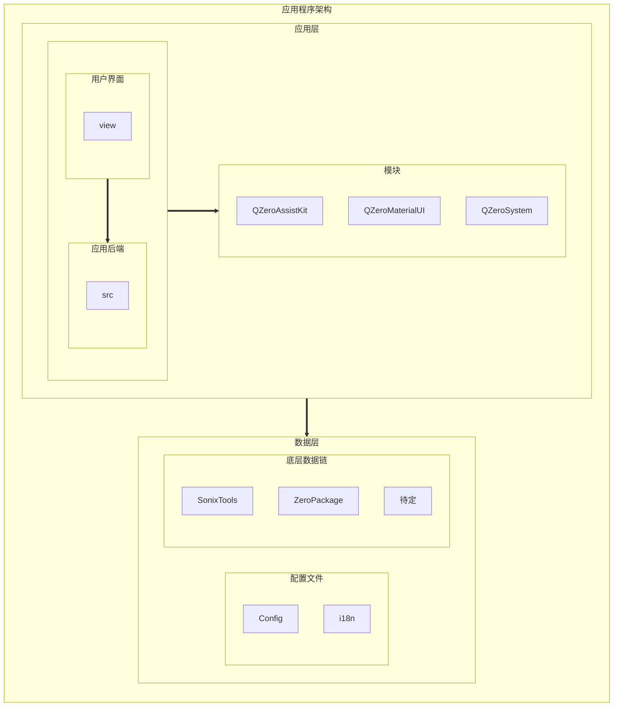

# 声美科技应用开发手册

---

- [项目结构](#项目结构)
  - [文本文档目录](#文本文档目录)
  - [构建及编译目录](#构建及编译目录)
  - [核心开发目录](#核心开发目录)
  - [第三方库以及模块目录](#第三方库以及模块目录)
  - [其他](#其他)
- [应用程序框架](#应用程序框架)
- [构建及编译](#构建及编译)
  - [开发环境搭建](#开发环境搭建)
  - [配置构建变量](#配置构建变量)
  - [编译输出](#编译输出)
- [附录](#附录)

---

## 项目结构

### 文本文档目录

- 开发文档：`doc\development`

### 构建及编译目录

- 构建编译配置：`presets`、`cmake`

- 构建编译脚本：`script`

- 编译输出地址：`build`

### 核心开发目录

- 应用层(后端)：`src`

- 用户界面(UI)：`view`

- 应用配置、资源及翻译文件：`config`、`i18n`

### 第三方库以及模块目录

- 基本工具类模块：`thirdparty\QZeroAssistKit`

- UI类模块：`thirdparty\QZeroMaterialUI`

- 系统相关类模块：`thirdparty\QZeroSystem`

- 协议传输类模块：`thirdparty\ZeroPackage`

- 专业性针对模块：`thirdparty\SonixTools`

- [ ] 数据及图像等核心交互性模块：`thirdparty\待定`

### 其他

- UI主题配置文本：`qtquickcontrols2.conf`

- 第三方官方库引用表：`vcpkg.json`

- CMake预设文件：`CMakePresets.json`

- CMake构建脚本文件：`CMakeLists.txt`

## 应用程序框架



## 构建及编译

### 开发环境搭建

- Qt版本：`6.8.x`

#### Windows

- 编译器版本：`Visual C++ 2022`

### Linux

- 编译器版本：`GCC -15.x`、`G++ -15.x`

### Android

- NDK版本：`27.2.x`
- Android API：`35`
- jdk版本：`17.x`

### 配置构建变量

1. 拉取`Vcpkg`包管理工具

```shell
1. git clone https://github.com/microsoft/vcpkg.git (本地存放地址)
2. cd (本地存放地址)
3. ./bootstrap-vcpkg.bat
```
<!-- markdownlint-disable-next-line -->
2. 进入`presets`目录

- 选择目标输出系统`.json`文件
- 根据本地环境配置相关环境变量地址即可

### 编译输出

1. 进入`script`目录;根据当前开发环境选择相应系统可执行脚本

```shell
# Windwos: 
buildApplication.ps1
# Linux: 
buildApplication.sh
```
<!-- markdownlint-disable-next-line -->
2. 脚本使用说明

```shell
# Windwos: 
.\script\buildApplication.ps1 -h
# Linux: 
 .\script\buildApplication.ps1 -h
```

<!-- markdownlint-disable-next-line -->
3. 构建编译

```shell
# 示例
# Windows
 .\script\buildApplication.ps1 -d a -t r -clean
# Linux 
 .\script\buildApplication.ps1 -d p -t d
```

## 附录

### 第三方模块地址

[https://github.com/Zerozany/QZeroAssistKit.git](https://github.com/Zerozany/QZeroAssistKit.git)

[https://github.com/Zerozany/QZeroMaterialUI.git](https://github.com/Zerozany/QZeroMaterialUI.git)

[https://github.com/Zerozany/QZeroSystem.git](https://github.com/Zerozany/QZeroSystem.git)

[https://github.com/Zerozany/ZeroPackage.git](https://github.com/Zerozany/ZeroPackage.git)

[https://github.com/Zerozany/SonixTools.git](https://github.com/Zerozany/SonixTools.git)
