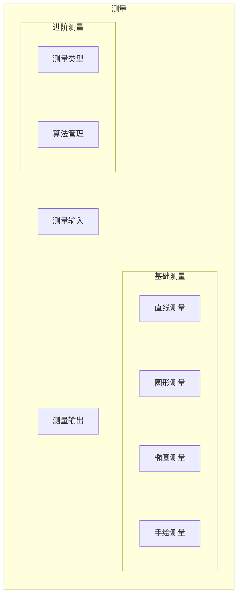
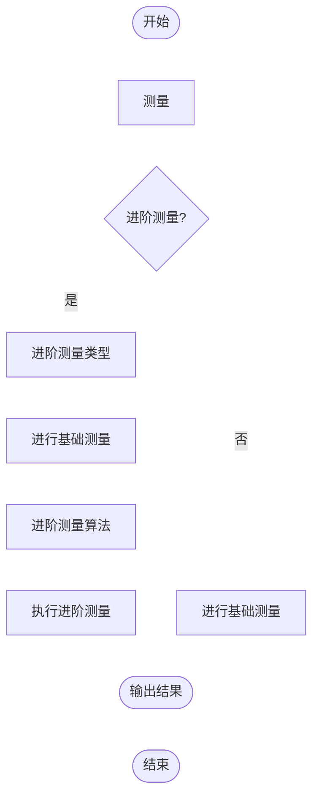

# 测绘测量

## 模块结构图



## 流程概述



## 目的

- 提供包含基础图形与进阶算法的标准化测量能力，确保进阶测量以基础测量为前提，实现高精度、可扩展的测绘流程与算法管理

## 模块统类

- 进阶测量类

```cpp
#include "MeasureKits.h"

class MeasureKits;
```

- 测量方法

```cpp
@param _measureType 测量类型及选项枚举值
@param args 测量填补参数 基本单位:cm
@return 测量值
template <typename T, typename... Args>
auto measure(T&& _measureType, Args&&... args) noexcept -> double;
```

- 测量类型及选项

1. 头文件

```cpp
#include "MeasureConfig.hpp"
```

<!-- markdownlint-disable MD029 -->
2. 可选类型
<!-- markdownlint-enable MD029 -->

```cpp
namespace Department
{

    enum class Obstetrics
    {
        BiparietalDiameter,
        HeadCircumference,
        AbdominalCircumference,
        CrownRumpLength,
        FemurLength,
    };

    enum class FetalWeight
    {
        Hadlock1,
        Hadlock2,
        Hadlock3,
        Hadlock4
    };

}  // namespace Department
```

- 使用示例

```cpp
#include "MeasureKits.h"
#include <print>

auto main(int argc, char const* argv[]) -> int
{
    MeasureKits measureKits{};
    double      femurLength{measureKits.measure(Department::Obstetrics::FemurLength, 2.84)};
    double      fetalWeight{measureKits.measure(Department::FetalWeight::Hadlock1, 4.95, 0.87)};
    std::println("femurLength:{}", femurLength);
    std::println("fetalWeight:{}", fetalWeight);
    return 0;
}
```
